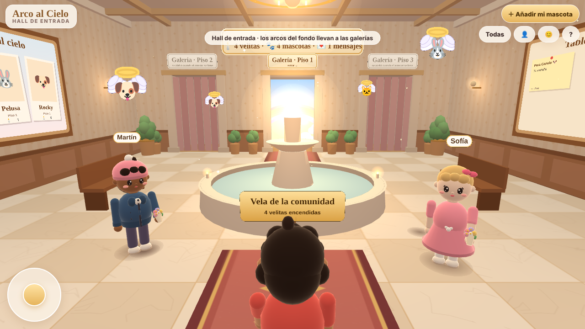
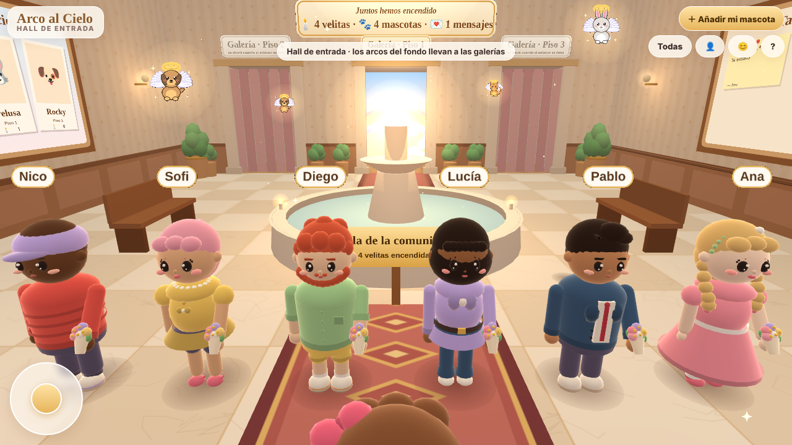

# Larc en Pet 🌈

Memorial 3D para mascotas en el navegador. Los visitantes entran a un hall compartido, crean su personaje y recorren galerías donde cuelgan la foto de su mascota. Ahí pueden encender velitas, dejar flores y regalos, soltar faroles y firmar el libro de visitas.



## Funciones

- **Hall de entrada compartido:** fuente con la vela de la comunidad, tablón de recuerdos, recién llegados y arcos que llevan a cada galería.
- **Galerías por pisos:** 10 lugares por piso, con una escalera al cielo. Cuando un piso se llena, se abre el siguiente.
- **Memorial de cada mascota:** foto, nombre, fechas, epitafio, velitas (duran 30 días), flores, regalos, faroles y libro de visitas.
- **Angelitos 2D:** cada mascota tiene un angelito ilustrado según su especie, con alas animadas y el color tomado de su foto.
- **Editor de personaje:** opciones distintas para mujer y hombre (cuerpo, peinados, ropa, calzado, accesorios), con tono de piel y colores.
- **Visitantes en vivo:** se ven los nombres de los demás visitantes y se pueden enviar saludos con emojis.
- **Tutorial de bienvenida** paso a paso.
- Se controla con toque, joystick, teclado (WASD o flechas) y arrastrando para girar la cámara.




## Cómo funciona por dentro

- Es un solo archivo `index.html`, sin dependencias ni paso de compilación. Incluye un motor WebGL propio (unas 1.500 líneas).
- Todas las texturas (madera, mármol, papel mural, letreros, angelitos) se generan con canvas al cargar la página. No usa imágenes externas.
- Los datos pasan por una capa de *backend* intercambiable:
  - **Dentro de Claude (artifact):** usa las capacidades `db` (datos compartidos) y `room` (presencia en vivo).
  - **Fuera de Claude (GitHub Pages, Netlify, etc.):** cae en **modo local**, donde todo se guarda en el `localStorage` de cada visitante.

> ⚠️ Para un sitio público compartido hace falta conectar un backend propio, por ejemplo Supabase, para guardar mascotas y ofrendas y para la presencia en tiempo real. Ver "Próximos pasos".

## Probar localmente

Abre `index.html` en el navegador, o sírvelo con:

```bash
python3 -m http.server 8000
# luego abre http://localhost:8000
```

## Publicar en GitHub Pages

1. Crea un repositorio (`larc-en-pet`) y sube estos archivos.
2. Ve a **Settings → Pages → Build and deployment**, elige **Deploy from a branch**, la rama `main` y la carpeta `/ (root)`.
3. En uno o dos minutos queda disponible en `https://jeanmunoz402-jpg.github.io/larc-en-pet/`.

## Próximos pasos para lanzarlo al público

1. **Backend compartido (Supabase):**
   - Tablas `pets` y `offerings`.
   - Bucket de Storage para las fotos.
   - Realtime Presence para los visitantes en vivo.
   - Un adaptador `setupSupabase()` junto a `setupDb()` y `setupLocal()`.
2. **Cuentas y moderación:**
   - Inicio de sesión por email o Google.
   - Un botón para reportar contenido y un panel de moderación.
   - Filtro de mensajes.
3. **Rendimiento:** las fotos deberían ir a Storage en vez de guardarse en base64 en la base de datos.
4. **Legal:** términos de uso y política de privacidad (fotos y mensajes de usuarios).
5. **Monetización** (ver el análisis en la conversación): plan "Luz eterna", recuerdos físicos con QR y alianzas con veterinarias o crematorios.

## Licencia

Por definir. Si quieres conservar los derechos para un producto comercial, publica el repositorio como **privado**, o como público con licencia "todos los derechos reservados".
